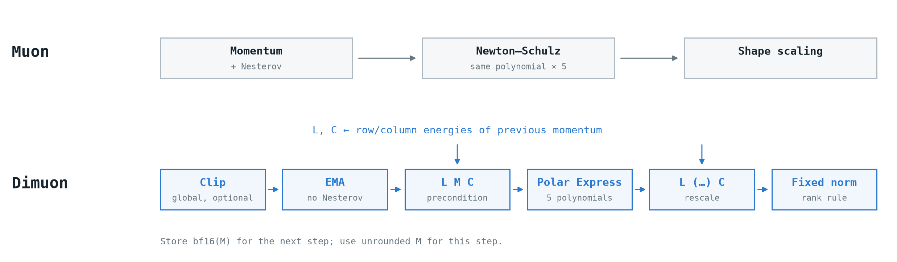
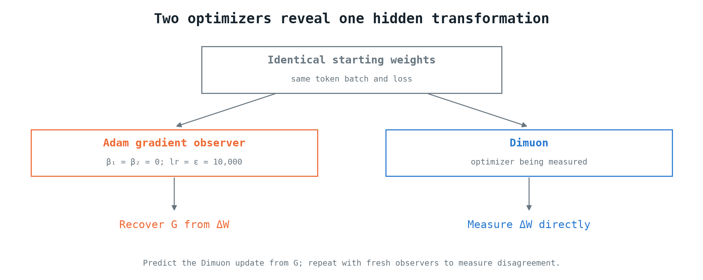
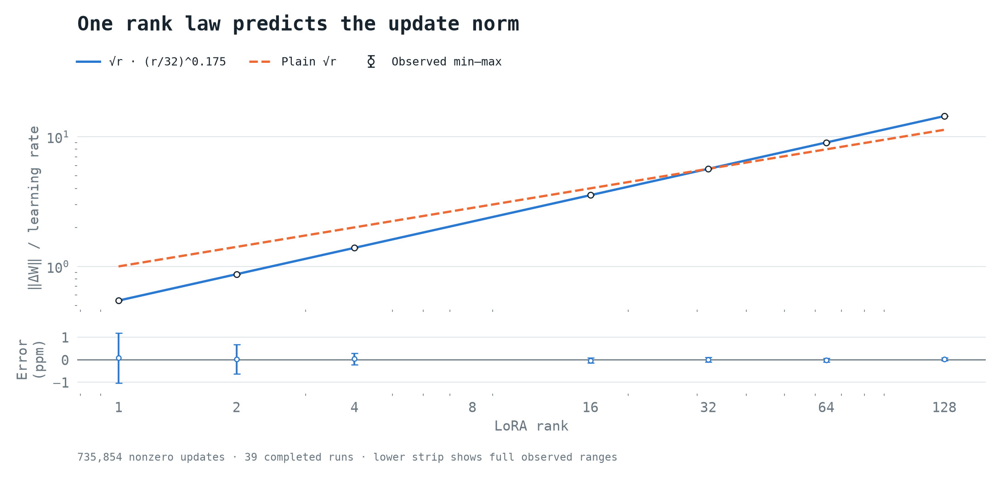
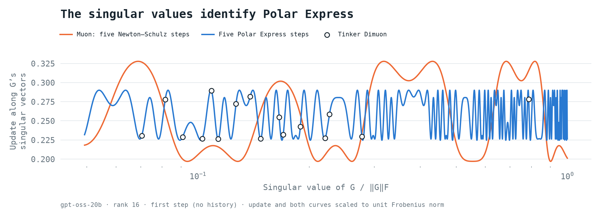
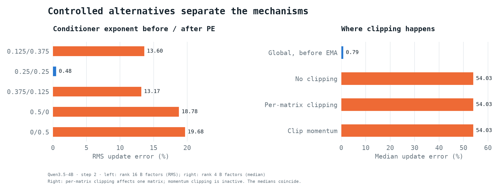
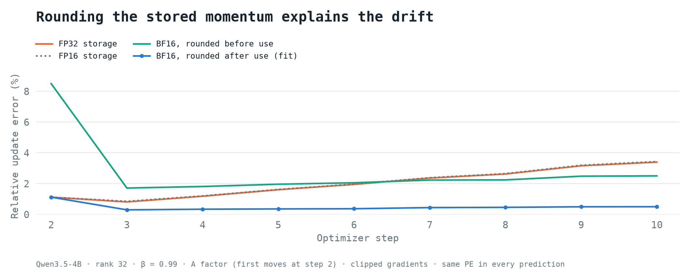
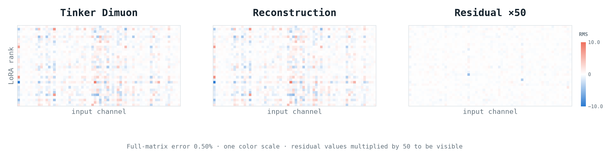

# Dimuon reverse engineered

**Muon with delayed diagonal conditioning, Polar Express, and a fixed update norm.**

[PyTorch implementation](dimuon.py)

Compared with [original Muon](https://github.com/KellerJordan/Muon/blob/master/muon.py):

| | Muon | Dimuon |
|---|---|---|
| Applied to | Hidden 2-D weights; AdamW elsewhere | Every LoRA factor, including the output layer; A and B separately; MoE experts separately; fused gate/up as one matrix |
| Momentum | EMA with Nesterov by default, β = 0.95 | Ordinary EMA, β = 0.9 by default |
| Conditioning | None | Previous momentum's row/column energies |
| Orthogonalization | One Newton–Schulz polynomial, five times; input `X / (‖X‖ + 1e-7)` | Five Polar Express polynomials; input `X / (1.01‖X‖)` |
| Update size | Matrix-shape scaling | `lr × √r × (r/32)^0.175` |
| Gradient clipping | None | Optional; one global norm, before momentum |
| Weight decay | Decoupled, default 0 | None |
| Precision | BF16 orthogonalization | FP16 orthogonalization; BF16 stored momentum |



Per LoRA factor, starting with zero momentum:

```python
G = clip_by_global_norm(G)  # across all factors, if enabled
old = momentum
rows = old.square().sum(dim=1)
cols = old.square().sum(dim=0)
L = (rows / rows.max() + 1e-4)**-0.25 if rows.any() else torch.ones_like(rows)
C = (cols / cols.max() + 1e-4)**-0.25 if cols.any() else torch.ones_like(cols)
M = beta * old + (1 - beta) * G
D = L[:, None] * PE5(L[:, None] * M * C[None, :]) * C[None, :]
if norm(D) > 0:
    W -= lr * sqrt(r) * (r / 32)**0.175 * D / norm(D)
momentum = bf16(M)  # store after using the unrounded M
```

`PE5` uses `X / (1.01 × ‖X‖F)` and the safety-adjusted
[Polar Express](https://arxiv.org/abs/2505.16932) coefficients in [dimuon.py](dimuon.py).

## How it was recovered

**1. Measure the gradient through Adam.** Start Adam and Dimuon clients from
identical adapter weights. Feed both the same token IDs, targets and loss
weights. Use a fresh Adam optimizer with both betas zero, no weight decay, no
clipping, and `lr = ε = 10,000`, and download the weights before and after its
first step:

$$
\Delta W=-\eta\frac{G}{|G|+\varepsilon}
\quad\Longrightarrow\quad
G=\frac{\varepsilon R}{1-|R|},\qquad R=-\Delta W/\eta.
$$

Inverting that update element by element recovers the gradient. Download
Dimuon's update separately, then test which transformation of the recovered G
reproduces it. This follows [Martin Marek](https://x.com/mrtnm)'s
optimizer-step probing approach for reverse engineering StableReinforce.



**2. Isolate the step size.** Divide each measured update's Frobenius norm by
its learning rate. Vary rank, gradient magnitude, model and matrix shape. The
result depends only on rank and follows `√r × (r/32)^0.175`: the log-log slope
is 0.675 rather than the 0.5 of plain `√r`. The lower strip shows the full
measured range at each rank; the worst discrepancy is about 1.2 parts per
million.



**3. Identify the orthogonalizer.** On the first step the optimizer history is
zero, so no conditioner is active. Compute the gradient's SVD and project the
measured update onto those singular vectors. Each candidate orthogonalizer
predicts a different response for each singular value. Five-step Polar Express
matches the measured, oscillating response; Muon's original Newton–Schulz
polynomial does not. A separate input-scale fit prefers `1/1.01` over `0.99`.



**4. Identify the history and diagonal scaling.** Run several steps with
different batches. Compare continued optimizer state with reset state, and
change β between steps. Zero-initialized ordinary EMA fits; first-gradient
initialization and Nesterov do not. Setting β to zero removes old momentum from
the new EMA, but its row/column scaling still affects the update: the
conditioner is computed from the previous momentum.

Higher-rank probes separate scaling before Polar Express from scaling after it.
The best split is a quarter-root on both sides. Independent sweeps on two runs
select the relative damping `1e-4` and the exponent `1/4`.

**5. Locate clipping.** Use an adapter with many matrices and a clipping
threshold below the global gradient norm, and carry momentum into the next
step. Compare clipping all raw gradients together, clipping each matrix
independently, and clipping the accumulated momentum. Only one global norm
applied **before** the momentum update fits. The two panels below are separate
controlled comparisons.



**6. Resolve precision.** FP16 Polar Express matches the rescaled update grid
and half-precision subnormal pattern. Separately,
β = 0.99 makes the precision of the stored momentum visible over time. FP32
storage drifts away from the server; rounding the stored copy once to BF16,
after using its unrounded value, removes most of that drift. Rounding before
use, truncating to BF16, and FP16 storage fit worse.



In the run shown, the step-10 A-factor error falls from **3.40% to 0.50%**.

**7. Check parameter boundaries and observers.** For MoE models, compare the
norm of the stacked tensor with the norm of each expert slice. Experts are
normalized separately; fused gate/up parameters are one matrix. An expert with
zero current gradient but nonzero momentum still takes a full-norm step.

Repeat the Adam observation at every step. Select the first observer whose
forward loss matches Dimuon's, without looking at prediction error; if none
matches, use observer zero and keep the step. Equal losses do not prove equal
gradients, so unmatched steps and outliers stay in the error distribution.

## Validation

39 completed runs, 13 models, ranks 1–128, β up to 0.99, and up to 20 steps.

| Models | Runs | Updates | p50 | p90 | p99 |
|---|---:|---:|---:|---:|---:|
| Qwen dense | 18 | 11,522 | 0.65% | 1.54% | 2.94% |
| Qwen MoE | 7 | 569,113 | 0.82% | 2.72% | 77.73% |
| gpt-oss-20b | 6 | 15,432 | 0.90% | 11.42% | 37.07% |
| Nemotron | 4 | 135,772 | 0.47% | 1.68% | 4.59% |
| Inkling-Small | 2 | 4,009 | 0.55% | 1.72% | 3.00% |
| Kimi-K2.6 | 1 | 3 | 0.35% | 0.40% | 0.41% |
| DeepSeek-V4.1-Flash | 1 | 3 | 0.36% | 0.53% | 0.57% |

Percentiles are over the relative Frobenius error of each nonzero factor or
expert update, pooled per row. The replay uses FP64 orthogonalization, BF16
stored momentum and the first loss-matched observer (else observer zero).
The largest tails are concentrated in three MoE runs; routing differences are
an unverified explanation. Kimi and DeepSeek have three updates each.

The heatmaps show a 32 × 64 slice of the step-10 A-factor update from the
momentum figure. The residual is multiplied by 50 to make it visible.



**Limits:** Not bit-exact: clients can compute different gradients from
identical inputs, and the server's FP16 rounding is not replicated. No tests
above rank 128 or beyond 20 steps. The norm rule's `32` cannot be separated
from LoRA alpha = 32. BF16 rounding at save time rather than in memory remains
possible.

## Use it

From a checkout:

```sh
uv sync --locked
uv run python
```

Or install into an existing environment with `pip install .`.

```python
import torch
from dimuon import Dimuon

weights = torch.nn.Parameter(torch.randn(32, 4))
optimizer = Dimuon([weights], lr=1e-3, beta1=0.9)
loss = weights.square().mean()
loss.backward()
optimizer.step()
optimizer.zero_grad()
```
